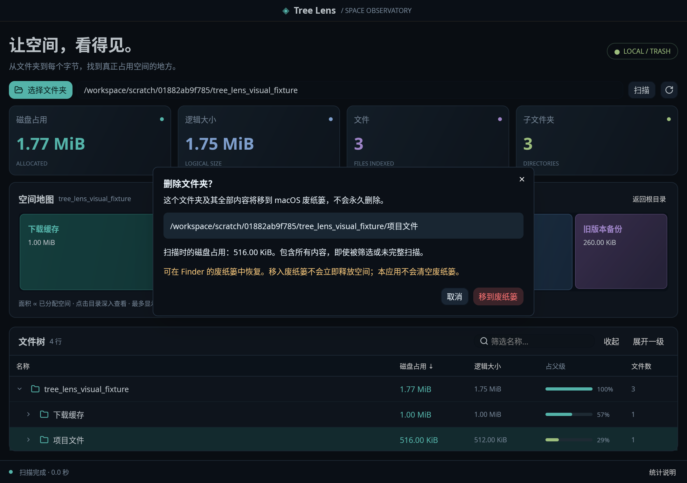

# Tree Lens 0.5.0 · macOS + Windows + Debian / Ubuntu

Rust 编写的原生磁盘空间分析工具。0.5 新增 Debian / Ubuntu Linux 桌面支持：X11 / Wayland 原生 GPUI 窗口、桌面门户目录选择器、本地化 XDG 文件夹快捷入口、文件管理器打开和需要确认的 FreeDesktop 回收站操作。保留 0.4 的 Windows x64 支持和 macOS 功能，继续使用 GPUI Kit 0.9.0，不是网页套壳。

> **验证状态：本次基于已合并 Windows 支持的 main `080f18a` 开发。Debian 13 本地验证与尚未执行的发行版/桌面验收详见 [TESTING.md](TESTING.md)。已添加 Debian 12/13 和 Ubuntu 22.04/24.04 CI，但配置不等于 CI 已通过。没有发布签名安装包。**

## 新界面



上图为新版删除确认框，由应用真实 GPUI 离屏渲染器生成，使用专门创建的示例目录，不是 macOS 实机截图。另见 0.3 基础界面历史预览：[宽窗口](docs/preview-wide.png)、[最小窗口](docs/preview-minimum.png)。

- 深蓝黑工作台、青绿主色、渐变统计卡片与彩色空间地图。
- 空间地图按真实分配量布局，点击目录可深入，支持返回根目录。最多保留 11 个直接子项和合并的剩余项，不复制完整扫描树。
- GPUI `uniform_list` 虚拟文件树：仅生成视口行，继续使用 0.2 的紧凑节点与按需树索引。
- 宽窗口显示快捷目录侧栏和项目详情栏；较窄窗口隐藏辅助侧栏，保持树列表宽度。
- GPUI Kit 原生输入、按钮、图标、上下文菜单、对话框和扫描动画。使用系统字体及其中文回退，不把整个 CJK 字体文件读入应用。
- 系统目录选择器由 GPUI 提供。Linux 使用 xdg-desktop-portal，需安装适配当前桌面的门户后端；可取消后重新选择，门户缺失时显示错误，也可直接输入路径。Windows 保留系统已知文件夹，Linux 读取 user-dirs.dirs，尊重本地化和重定向。

## 保留的功能

文件夹选择、绝对路径/`~` 输入、文件夹拖放、后台扫描、最新进度合并、取消及部分结果提示、刷新、目录展开/收起、四种排序、180ms 防抖名称筛选、复制完整路径、Finder / Windows 资源管理器显示 / Linux 文件管理器打开与读取问题列表。

保留紧凑扫描树、按需索引、`uniform_list` 虚拟行和 180ms 筛选防抖；没有复制完整树来实现多平台支持。扫描时不读取文件内容，不上传结果。移动到系统回收站/废纸篓必须由你单独确认。符号链接不展开，硬链接分配空间在同次扫描中去重，跨设备挂载点跳过。Linux 还读取 `/proc/self/mountinfo`，跳过同设备 bind mount 等已知子挂载点，并拒绝经过符号链接上级的扫描根路径；挂载表不可读时明确失败。Windows 额外跳过全部重解析点（包括目录联接点、云占位文件），避免循环和主动下载。

## 在 Debian / Ubuntu 上运行

构建目标为 Debian 12/13、Ubuntu 22.04/24.04 的本地桌面环境。首次构建需 Rust 1.92+ 及图形开发依赖。推荐 x86_64；ARM64 打包逻辑已提供但本次未验证。完整说明见 [Linux 构建、依赖与验收](docs/LINUX.md)。

```sh
bash scripts/install-linux-deps.sh --print  # 先查看依赖
sudo bash scripts/install-linux-deps.sh    # 仅在你决定安装依赖后执行
cargo run --locked --release -- "$HOME"
bash scripts/bundle-linux.sh
```

打包脚本按本机发行版/版本/架构输出 `.deb` 和 tar.gz，绝不把 Debian 13 二进制宣称为 Ubuntu 22.04 通用包。已有对应版本的 `.deb` 时用 `sudo apt install ./Tree-Lens-*.deb` 安装。不要以 root 身份运行界面。需要正常的 X11 或 Wayland 会话、字体、图形驱动及 D-Bus/桌面门户，纯服务器或 SSH 无显示环境请使用核心扫描示例。

Linux 快捷键为 Ctrl+O/R/F/Q。文件管理器操作打开目录本身或文件的父目录，不保证高亮单个文件。`tree-lens --version` / `--help` 不需要显示系统。回收站使用 `/usr/bin/gio trash`，不使用 shell 拼接，也不回退到永久删除。

## 在 Windows 上运行

目标为 Windows 10 1809+ / Windows 11 x64，使用 MSVC 工具链、Visual Studio C++ Build Tools 和 Windows SDK。完整安装要求及 Direct3D 11 图形环境说明见 [Windows 构建说明](docs/WINDOWS.md)。

```powershell
cargo run --locked --release -- 'C:\Users\你的用户名\Downloads'
./scripts/bundle-windows.ps1
```

打包后输出 `dist/Tree-Lens-Windows-x64.zip`，解压后运行 `tree-lens.exe`。release 不弹出额外控制台；ZIP 未签名，运行库要求见 Windows 文档。CI 工作流会构建完整 GUI release，而不只检查核心库。

Windows 快捷键：`Ctrl+O` 选择目录、`Ctrl+R` 刷新、`Ctrl+F` 筛选、`Ctrl+Q` 退出、`Esc` 关闭弹窗或取消扫描。接受绝对盘符路径、UNC 路径及 `~`、`~/`、`~\` 主目录输入；有歧义的 `C:folder` 驱动器相对路径明确拒绝。网络文件系统不支持所需元数据时显示错误或不完整统计，不冒充精确占用。

## 删除文件夹

1. 扫描要处理的文件夹的**父目录**，等待扫描结束。
2. 在文件树中右键目标文件夹，选择 **删除文件夹…（移到废纸篓/回收站）**。宽窗口也可用右侧详情栏的「删除文件夹…」。
3. 核对确认框中的完整路径，再点击 **移到废纸篓/回收站**。取消、Esc 或关闭确认框不会删除；单按 Enter 不会默认确认。
4. 成功后自动重新扫描，清除筛选和旧选择，回到根目录并更新统计与空间地图。

**行为与安全边界：**

- macOS 使用原生废纸篓；Windows 使用原生 Shell 回收站；Linux 通过 GIO 使用 FreeDesktop 回收站。移动的是整个文件夹及全部内容，包括筛选隐藏、未完整统计及扫描后新增的内容。
- 不永久删除，不清空废纸篓，不在失败时尝试其他删除方式。可在系统废纸篓/回收站中恢复；移入废纸篓不会立即释放磁盘空间。
- 当前扫描根目录、文件、符号链接、跨设备目录不能删除。Linux 拒绝目标及其内部的挂载点（包括 bind mount）；Windows 还拒绝重解析点和联接点，只支持本地固定磁盘，不支持网络共享、可移动磁盘或设备路径。回收站不接受的项目明确失败，不自动永久删除。想处理某个根目录，请改为扫描它的父目录。
- 执行前再次检查目录和上级路径身份。目标丢失、被替换、变成符号链接或无权限时显示错误，不自动重试。不提权、不改变权限。
- 路径使用操作系统原生编码，不会用显示用的替换字符执行操作。不能准确显示为 Unicode 的路径（包括 macOS 非 UTF-8、Windows 未配对 UTF-16 代理项）明确拒绝删除，请在系统文件管理器中处理。
- 原生废纸篓使用路径接口，检查与实际移动之间仍有极短的竞争窗口，不能防御其他进程同时恶意替换路径。确认后请勿并行移动、重命名目标或其上级目录。
- 普通自动化删除测试使用合成临时目录和模拟后端。Linux 另有显式启用的 GIO 集成测试，隔离 HOME/XDG_DATA_HOME，仅验证自己生成的测试目录及回收元数据，不操作正常用户回收站。

## 在 Mac 上运行

当前 GPUI Kit 官方要求 **macOS 15 或更高版本**、Xcode Command Line Tools、**Rust 1.92 或更新版本**。这比 0.2 的系统要求更高。请先确认本机满足要求。

1. 如尚未安装 Apple 开发工具：`xcode-select --install`。
2. 从 [Rust 官方网站](https://rust-lang.org/tools/install/) 安装 Rust，重新打开终端后检查 `rustc --version` 和 `cargo --version`。
3. 在项目目录执行：

```sh
cargo run --locked --release
```

指定扫描目录：

```sh
cargo run --locked --release -- "$HOME/Downloads"
```

本包包含本次解析生成的新版 `Cargo.lock`，`gpui-kit` 固定为 `=0.9.0`。请保留锁文件并使用 `--locked`，不要用旧版 egui 锁文件替换。

快捷键：`⌘O` 选择文件夹、`⌘R` 刷新、`⌘F` 筛选、`Esc` 关闭对话框或取消扫描、`⌘Q` 退出。Windows 和 Linux 使用 Ctrl+O/R/F/Q。

## 打包

```sh
bash scripts/bundle-macos.sh
open "dist/Tree Lens.app"
```

脚本使用包内锁文件构建，仅在锁文件缺失时生成，最低系统设为 macOS 15。默认生成当前 Mac 架构；可传入 `aarch64-apple-darwin` 或 `x86_64-apple-darwin`，需先安装对应 Rust target。它不是 Universal Binary 构建器。

本机开发 `.app` 不包含 Developer ID 签名和 Apple 公证。公开分发需独立完成自己的签名、公证和真实 Mac 验收；项目不绕过 Gatekeeper。

## 验证

```sh
cargo fmt --all -- --check
cargo test --locked --no-default-features --all-targets
cargo check --locked --all-targets
cargo test --locked --features ui-tests --all-targets
cargo clippy --locked --features ui-tests --all-targets -- -D warnings
cargo run --locked --no-default-features --example scan -- src
```

核心测试不需要显示系统。GUI 完整编译仍需要平台依赖。Linux 要求及 macOS 最低版本参见 [GPUI Kit 官方安装文档](https://gpui-kit.com/docs/installation/)。仓库附带 macOS 15、Windows Server 2022、Debian 12/13 和 Ubuntu 22.04/24.04 CI 工作流。是否实际执行及其结果以 [TESTING.md](TESTING.md) 和 GitHub Actions 为准。

手动验收：选择目录 → 关闭选择器 → 再选择 → 展开/收起 → 排序/筛选/清除 → 点击地图深入/回根 → 复制/Finder → 扫描时取消 → 立即重复点击 → 完成后重扫 → 拖入目录 → 读取错误 → 说明弹窗 Esc/Tab → 最小/宽窗口 → 中文长路径 → 扫描中关闭窗口。

## 统计口径

- **磁盘占用**：Unix `metadata.blocks() × 512`，包括目录元数据。Windows 从只读元数据句柄读取 `FileStandardInfo.AllocationSize`；稀疏/压缩文件读取 `FileCompressionInfo.CompressedFileSize`。Windows 目录本身的分配量记 0（目录索引/文件系统元数据不可靠归属），只汇总后代。查询失败显示问题，未知占用记 0 并标记不完整，不用逻辑长度冒充。**逻辑大小**为非目录项目长度，目录为后代长度之和。
- **硬链接**：Unix 同一 `(device, inode)`，Windows 同一 `(volume serial, 128-bit file ID)` 的非目录项目只贡献一次分配空间；逻辑大小按路径计数。贡献哪个路径由枚举顺序决定。
- **APFS**：克隆、共享块、快照、压缩和可清除空间不能靠 `stat` 精确归属。此值不等于删除后可释放空间，也不保证与系统储存空间一致。
- **Windows**：NTFS/ReFS 去重、共享块、快照和卷元数据同样不能精确归属。Windows 文件系统若不能提供文件 ID/分配量，结果将失败或明确标为部分统计。
- **Linux**：Btrfs/ZFS reflink、压缩、快照和文件系统预留空间不能靠 `st_blocks` 精确归属；ext4 等普通文件的分配量以文件系统报告为准。挂载表是扫描开始时的快照，扫描期间挂载变化仍可能影响结果。
- **iCloud**：不主动读取文件内容或请求下载，元数据访问仍由系统与提供商处理。
- **权限**：问题单独记录，不提权、不修改权限。需要时可由你自行在系统设置中授权完全磁盘访问，不必为普通目录扫描开启。
- **一致性**：扫描为实时尽力而为视图，不是原子快照；扫描中变化及路径替换竞争可能影响结果。
- **容量**使用 1024 进制的 KiB/MiB/GiB。文件数只计常规文件。
- **内存**仍随扫描项目数增长。0.2 的内存基准可在 [benchmarks/README.md](benchmarks/README.md) 复现；它不是 0.3 GPUI 整个进程的内存或 GPU 基准。新版不声称降低整体 GUI 内存或提高特定帧率。

## 结构与来源

- `src/main.rs`：GPUI Kit 启动、原生窗口、主题与生命周期。
- `src/app.rs`：GPUI Kit 界面、系统选择器、虚拟列表、菜单和对话框。
- `src/session.rs`：独立 GUI 的扫描会话、取消、进度与筛选。
- `src/deletion.rs`：文件夹身份验证、单次确认请求及 macOS / Windows / Linux 回收后端。
- `src/footprint.rs`：有界面积图投影、布局测试。
- `src/scanner.rs` / `src/tree.rs`：跨平台扫描及低内存虚拟树。
- `src/windows_fs.rs` / `src/linux_fs.rs` / `src/platform.rs`：平台元数据、Linux 挂载表、系统文件夹路径和平台文案。
- `scripts/bundle-macos.sh` / `scripts/bundle-windows.ps1` / `scripts/bundle-linux.sh`：本地 `.app` / Windows ZIP / Linux `.deb` 与 tar.gz；`.github/workflows/`：平台检查。

采用 Longbridge 的 [GPUI Kit](https://github.com/longbridge/gpui-kit)，核对了 crates.io 发布的 0.9.0 源码及其 GPUI 0.3.11 API。官方入口是 `gpui_kit::*` 和 `gpui_kit::component`，不是另一个同名库。参考：[开始使用](https://gpui-kit.com/docs/getting-started/)、[任务与后台执行](https://gpui-kit.com/docs/task/)。第三方软件保留各自许可证。

## 可复现的界面检查

`ui-tests` 启用 GPUI Kit 官方测试支持。`examples/ui_snapshot.rs` 使用真实离屏 GPU 渲染器，可在有可用图形驱动的开发环境生成界面图，不以浏览器或手绘图替代。

```sh
cargo run --locked --features ui-tests --example ui_snapshot -- src preview.png
```

它等待约 1.5 秒让扫描进度汇入界面。大目录若尚未完成，截图会保留真实的扫描中状态。离屏检查不替代 macOS 系统选择器、Finder、窗口拖放和隐私权限验收。


### 删除确认框预览

使用测试特性生成确认框截图，不执行删除：

```sh
cargo run --locked --features ui-tests --example ui_snapshot -- /path/to/sample-root delete-preview.png 1080 760 --delete-dialog
```

示例目录需包含至少一个子文件夹。此预览替换为拒绝操作的模拟后端，即使点击确认也不会删除。实际 macOS 废纸篓、权限错误与恢复步骤仍需实机验收。
